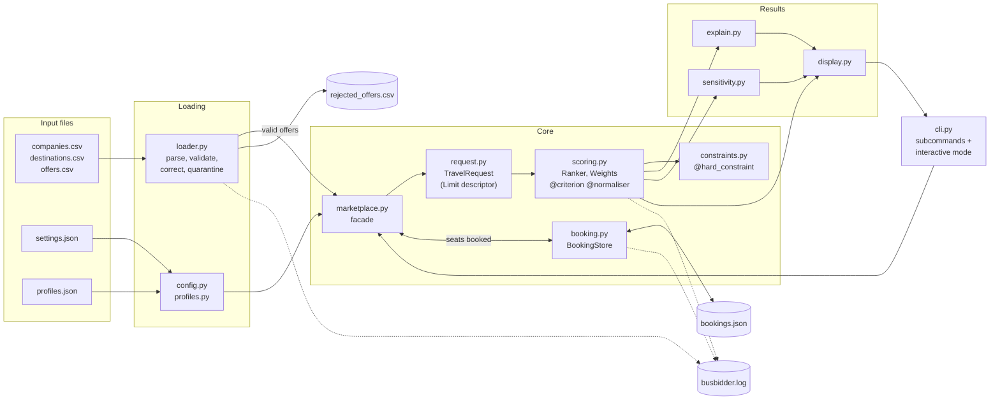
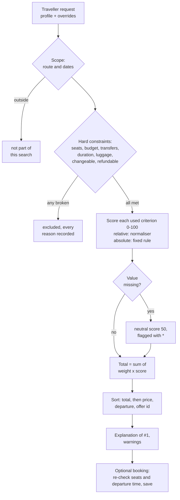

# Architecture

## Components and flow of information

## Ranking pipeline

## Module responsibilities

| Module | Responsibility | Main names |
|---|---|---|
| `errors.py` | One exception hierarchy for every expected failure | `BusBidderError` and subclasses |
| `models.py` | Immutable domain objects | `Company`, `Destination`, `FareConditions`, `Offer`, `Booking` |
| `loader.py` | Read CSV files, validate, correct, quarantine | `load_catalogue`, `validate_offer`, `Catalogue` |
| `request.py` | What the traveller asked for | `TravelRequest`, `Limit` (descriptor), `DepartureWindow` |
| `constraints.py` | Hard constraints, registered by decorator | `@hard_constraint`, `apply_hard_constraints` |
| `scoring.py` | Normalisers, criteria, weights, ranker | `@normaliser`, `@criterion`, `Weights`, `Ranker` |
| `profiles.py` | Named traveller profiles read from JSON | `TravellerProfile`, `load_profiles` |
| `explain.py` | Explanation generated from the scores | `explain` |
| `sensitivity.py` | Does the winner survive weight changes? | `weight_sensitivity`, `normaliser_comparison` |
| `booking.py` | Simulated bookings, references, capacity | `BookingStore`, `parse_reference` |
| `marketplace.py` | Facade connecting the parts | `Marketplace` |
| `display.py` | Text formatting only | `render_*`, `table` |
| `cli.py` | Commands and interactive mode | `main`, `cmd_interactive` |
| `config.py`, `logging_setup.py` | Settings and log file | `Settings`, `configure_logging` |
